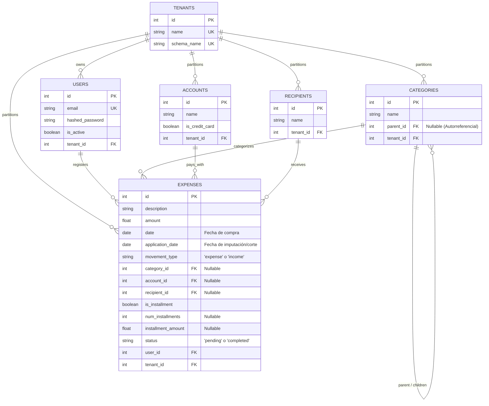

# Especificación Técnica y Guía de Migración de Stack
## Sistema de Gestión de Gastos Personales (Personal Expenses Manager)

Este documento contiene la **especificación técnica exhaustiva, modelo de dominio, reglas de negocio, contratos de API, integración de IA y lineamientos de UX** del proyecto, diseñado para servir como manual de referencia absoluto ante una migración o reescritura en cualquier otro stack tecnológico (e.g., Next.js, Go, NestJS, Flutter, React Native, Spring Boot, etc.).

---

## 1. Resumen Ejecutivo y Dominio de la Aplicación

### 1.1. Propósito del Sistema
El sistema es una **plataforma de gestión financiera personal multi-inquilino (multi-tenant)** diseñada con enfoque **Mobile-First**. Su objetivo es simplificar al máximo el registro de gastos diarios e ingresos mediante:
1. **Captura Rápida Asistida por IA**: Entrada de gastos por voz (transcripción + NLP) o fotografía de tickets/recibos (OCR + LLM) que alimentan una bandeja de entrada (**Inbox**) en estado pendiente.
2. **Registro Manual Ágil**: Formulario con selector jerárquico de categorías (árbol en modal), creación en el acto de entidades vinculadas y cálculo en tiempo real del valor de cuota.
3. **Simulación de Tarjetas de Crédito**: Gestión de compras en cuotas con fechas de imputación diferidas (corte y vencimiento).
4. **Reportes y Analítica Financiera**: Comparativa mensual, balance de ingresos vs. egresos, resumen de consumos de tarjetas y drill-down jerárquico de categorías con variación porcentual contra el mes anterior.
5. **Gestión y Portabilidad de Datos**: Exportación total en archivo ZIP (con múltiples CSVs) y reinicio seguro con re-sembrado de categorías base.

### 1.2. Actores del Sistema
- **Usuario Final**: Persona autenticada que gestiona sus transacciones, cuentas, categorías y beneficiarios dentro de su propio espacio de datos (tenant).

---

## 2. Arquitectura Actual y Componentes de Software

```mermaid
graph TD
    subgraph Frontend ["Frontend (Vue 3 + Vite)"]
        UI[Mobile-First UI: Bootstrap 5 + Icons]
        Pinia[Stores: Auth, Expense, Category, Account, Recipient]
        Router[Vue Router + Auth Guard]
        WebSpeech[Web Speech API (es-ES)]
        Axios[Axios Interceptors: Bearer Token + Auto-Refresh]
    end

    subgraph ReverseProxy ["Nginx / Dev Proxy"]
        Proxy[Proxy /api -> Backend:8000]
    end

    subgraph Backend ["Backend (FastAPI + Python 3.12)"]
        Auth[OAuth2 / JWT + Passlib PBKDF2]
        Routers[Routers: Auth, Expenses, Categories, Accounts, Recipients, Voice, Backup]
        CRUD[Lógica de Negocio, Fechas e Imputaciones]
        Alembic[Migraciones Alembic]
        Gemini[Google Generative AI: Flash Models Fallback Engine]
    end

    subgraph Database ["Base de Datos"]
        PostgreSQL[(PostgreSQL 15)]
    end

    UI --> Axios
    WebSpeech --> Axios
    Axios --> Proxy
    Proxy --> Routers
    Routers --> Auth
    Routers --> CRUD
    Routers --> Gemini
    CRUD --> PostgreSQL
```

### 2.1. Stack Tecnológico Actual
| Capa | Tecnología | Rol |
| :--- | :--- | :--- |
| **Frontend** | Vue 3 (Composition API / `<script setup>`), Vite | SPA reactiva y ligera |
| **Gestión de Estado** | Pinia | Stores modulares para autenticación y entidades |
| **Estilos y UI** | Bootstrap 5, Bootstrap Icons, CSS custom | Look & feel Mobile-First, bordes `rounded-4`, drag handles |
| **Gráficos** | Chart.js, vue-chartjs | Gráficos de dona (categorías) y barras (balance) |
| **Backend** | FastAPI (Python 3.12), Pydantic v2 | API REST asíncrona, validación estricta y Swagger docs |
| **ORM & Migraciones** | SQLAlchemy, Alembic | Acceso relacional y versionado de esquema |
| **Base de Datos** | PostgreSQL 15 | Almacenamiento relacional multi-tenant |
| **Autenticación** | JWT (`python-jose`), `passlib` (PBKDF2 SHA-256) | Tokens de 5 minutos + Refresh tokens de 24h |
| **Inteligencia Artificial** | Google Gemini (`google-generativeai`) | Extracción de datos financieros estructurados desde audio e imagen |
| **Despliegue** | Docker, Docker Compose, Nginx | Ambientes de desarrollo y producción containerizados |

---

## 3. Modelo de Datos y Esquema de Base de Datos

### 3.1. Diagrama Entidad-Relación (ERD)



### 3.2. Diccionario de Datos Detallado

#### 1. Tabla `tenants`
Aísla la información por cliente/espacio.
- `id`: Entero, PK autoincremental.
- `name`: String, único, indexado. Nombre del tenant.
- `schema_name`: String, único, indexado. Slug en minúsculas con guiones bajos (`name.lower().replace(" ", "_")`).

#### 2. Tabla `users`
- `id`: Entero, PK autoincremental.
- `email`: String, único, indexado. Identificador de login.
- `hashed_password`: String. Hash generado mediante PBKDF2-SHA256.
- `is_active`: Booleano (default `True`).
- `tenant_id`: Entero, FK -> `tenants.id`.

#### 3. Tabla `categories`
Estructura en árbol con jerarquía autorreferencial.
- `id`: Entero, PK autoincremental.
- `name`: String, indexado.
- `parent_id`: Entero, FK -> `categories.id`, nullable. Si es `null`, es una categoría raíz (padre). Si tiene valor, es una subcategoría. Borrado en cascada `delete-orphan`.
- `tenant_id`: Entero, FK -> `tenants.id`.

#### 4. Tabla `accounts`
Representa billeteras, efectivo, bancos o tarjetas.
- `id`: Entero, PK autoincremental.
- `name`: String, indexado.
- `is_credit_card`: Booleano (default `False`). Si es `True`, activa las reglas de diferimiento de fecha de aplicación y cuotas.
- `tenant_id`: Entero, FK -> `tenants.id`.

#### 5. Tabla `recipients`
Beneficiario o persona destinataria del movimiento ("Para...").
- `id`: Entero, PK autoincremental.
- `name`: String, indexado.
- `tenant_id`: Entero, FK -> `tenants.id`.

#### 6. Tabla `expenses`
Registro de todas las transacciones (gastos o ingresos).
- `id`: Entero, PK autoincremental.
- `description`: String, indexado. Detalle del gasto (ej.: *"Supermercado (Cuota 1/3)"*).
- `amount`: Float / Numeric(12, 2). Monto imputado al registro.
- `date`: Date (YYYY-MM-DD). Fecha real de la transacción o compra.
- `application_date`: Date (YYYY-MM-DD). Fecha de impacto contable (por defecto igual a `date`, salvo en tarjetas de crédito).
- `movement_type`: String. Valores admitidos: `"expense"` (gasto) o `"income"` (ingreso).
- `category_id`: Entero, FK -> `categories.id`, nullable.
- `account_id`: Entero, FK -> `accounts.id`, nullable.
- `recipient_id`: Entero, FK -> `recipients.id`, nullable.
- `is_installment`: Booleano (default `False`).
- `num_installments`: Entero, nullable. Cantidad total de cuotas del plan.
- `installment_amount`: Float / Numeric(12, 2), nullable. Monto individual de cada cuota.
- `status`: String (default `"completed"`). Valores:
  - `"pending"`: Movimiento creado por IA en espera de revisión/aprobación manual en Inbox.
  - `"completed"`: Movimiento confirmado y computado en reportes.
- `user_id`: Entero, FK -> `users.id`.
- `tenant_id`: Entero, FK -> `tenants.id`.

---

## 4. Sembrado Inicial de Datos (Default Categories)

Al registrar un nuevo usuario (y crearse su tenant) o al solicitar un **Reset de Cuenta**, el backend ejecuta `seed_tenant_categories()`, creando 11 categorías padre con sus respectivas subcategorías:

1. **Hogar**: Alquiler / Hipoteca, Expensas, Luz, Gas, Agua, Internet, Cable / TV, Reparaciones, Muebles / Equipamiento.
2. **Alimentación**: Supermercado, Verdulería, Carnicería, Restaurante, Delivery, Café / snacks.
3. **Transporte**: Combustible, Transporte público, Uber / Taxi, Peajes, Estacionamiento, Mantenimiento auto, Seguro auto.
4. **Salud**: Farmacia, Médico, Estudios, Odontología, Obra social / prepaga.
5. **Compras personales**: Ropa, Tecnología, Electrónica, Regalos, Belleza / peluquería.
6. **Entretenimiento**: Salidas, Cine / teatro, Streaming, Videojuegos, Eventos.
7. **Educación**: Colegio, Universidad, Cursos, Libros, Material escolar.
8. **Servicios y suscripciones**: Netflix, Spotify, Apps, Software, Cloud / almacenamiento.
9. **Finanzas**: Impuestos, Comisiones bancarias, Intereses, Seguros, Gastos administrativos.
10. **Ahorro / Inversión**: Transferencia a ahorro, Compra de dólares, Inversiones, Criptomonedas, Plazo fijo.
11. **Ingresos**: Sueldo, Freelance, Ventas, Intereses, Otros ingresos.

---

## 5. Reglas de Negocio y Algoritmos Críticos

### 5.1. Regla de Tarjeta de Crédito (Corte y Fecha de Aplicación)
Si un gasto se imputa a una cuenta con `is_credit_card == True`:
- La `date` conserva la fecha exacta de compra ingresada por el usuario.
- La `application_date` se calcula como **el día 10 del mes siguiente** a la compra:
  $$\text{año\_apli} = \text{si mes} = 12 \implies \text{año} + 1 \text{ sino año}$$
  $$\text{mes\_apli} = \text{si mes} = 12 \implies 1 \text{ sino mes} + 1$$
  $$\text{application\_date} = \text{Date}(\text{año\_apli}, \text{mes\_apli}, 10)$$

### 5.2. Regla de Multi-Cuotas (Desglose en Base de Datos)
Cuando un gasto se registra con `is_installment == True` y `num_installments > 0`:
1. El backend **desglosa la compra en $N$ registros individuales** en la tabla `expenses`.
2. Monto de cuota:
   $$\text{installment\_amount} = \text{round}\left(\frac{\text{amount}}{\text{num\_installments}}, 2\right)$$
3. Cada registro $i$ (con $i \in [0, N-1]$) se guarda con:
   - `description`: `"{description} (Cuota {i+1}/{num_installments})"`
   - `amount`: `installment_amount`
   - `is_installment`: `True`
   - `num_installments`: $N$
   - `installment_amount`: `installment_amount`
   - `date`: fecha de compra original.
   - `application_date`: incrementada $i$ meses a partir de la fecha de aplicación inicial (manejando fin de mes si el mes destino tiene menos días).

### 5.3. Conversión de Movimiento en Inbox a Cuotas (Edición Especial)
Si un gasto ingresó por IA sin cuotas (`is_installment == False`) y el usuario lo edita para convertirlo en cuotas:
- El registro original existente se modifica para convertirse en la **Cuota 1**:
  `description = f"{original} (Cuota 1/{num_installments})"` y `amount = installment_amount`.
- Se generan e insertan en la BD los registros restantes correspondientes a las **Cuotas 2 a N**.

### 5.4. Ordenamiento Obligatorio
Todos los listados de movimientos deben ordenarse descendentemente por fecha y por ID:
$$\text{ORDER BY } \text{date DESC, id DESC}$$

### 5.5. Algoritmo de Reporte Jerárquico de Categorías (Drill-Down)
El endpoint `/expenses/reports/by-category`:
1. Recibe `month`, `year` y opcionalmente `parent_id` (nivel raíz si es `None`).
2. Obtiene los gastos del mes actual y del mes inmediato anterior (manejando transición de enero al diciembre previo) que cumplan:
   $$\text{status} = \text{'completed'} \land \text{movement\_type} = \text{'expense'} \land \text{month}(\text{application\_date}) = m \land \text{year}(\text{application\_date}) = y$$
3. Para cada categoría del nivel solicitado (`parent_id`):
   - Obtiene recursivamente todos sus `descendant_ids` (la categoría misma más todos sus hijos, nietos, etc.).
   - Suma el total del mes actual y el mes anterior para todo gasto con `category_id \in descendant_ids`.
   - Calcula la variación porcentual contra el mes anterior:
     $$\text{diff\_percent} = \begin{cases} 
     \frac{\text{actual} - \text{anterior}}{\text{anterior}} \times 100 & \text{si anterior} > 0 \\
     100 & \text{si anterior} = 0 \land \text{actual} > 0 \\
     0 & \text{en otro caso}
     \end{cases}$$
4. En el nivel raíz (`parent_id == None`), agrega el nodo sintético **"Sin Categoría"** (gastos con `category_id == null`).
5. Ordena los resultados de mayor a menor según el monto total actual.

---

## 6. Sistema de Inteligencia Artificial (Gemini Fallback Engine)

### 6.1. Casos de Uso
1. **Audio (Voz a Texto)**: La app web usa `webkitSpeechRecognition` o `SpeechRecognition` con `lang = 'es-ES'`. El texto transcrito se envía al endpoint `/process-voice-and-save`.
2. **Imagen (Ticket / Recibo)**: Captura fotográfica con `<input capture="environment">`. La imagen binaria se envía vía `multipart/form-data` al endpoint `/process-image-and-save`.

### 6.2. Motor de Fallback de Modelos Gemini
Para mitigar límites de cuota (HTTP 429) o modelos deprecados (HTTP 404) en el Free Tier de Google AI Studio:
1. El backend consulta los modelos disponibles con soporte `generateContent`.
2. Filtra y descarta versiones que no tienen cuota en Free Tier (`2.5`, `3.0`, `3.1`).
3. Ordena los modelos según prioridad de estabilidad comprobada:
   ```
   flash-latest  -->  1.5-flash  -->  pro-latest  -->  1.5-pro  -->  2.0-flash
   ```
4. Itera secuencialmente la lista intentando la generación. Si captura errores 429 o 404, prueba con el siguiente modelo.

### 6.3. Extracción de JSON y Heurística de Asociación
El prompt exige respuesta pura en formato JSON con la siguiente firma:
```json
{
  "amount": 1500.50,
  "description": "Compra en farmacia",
  "date": "2026-09-21",
  "movement_type": "expense",
  "account_hint": "galicia",
  "installments": 3,
  "recipient_hint": "farmacity",
  "category_hint": "salud"
}
```
**Asociación Fuzzy**:
El backend busca coincidencias parciales (case-insensitive substring) en la BD del tenant para:
- `account_hint` $\to$ Busca en nombres de `accounts`.
- `category_hint` $\to$ Busca en nombres de `categories`.
- `recipient_hint` $\to$ Busca en nombres de `recipients`.

El movimiento resultante **siempre se guarda con `status: "pending"`**, garantizando que el usuario deba validarlo en el **Inbox**.

---

## 7. Catálogo Completo de APIs (Endpoints REST)

Todas las rutas tienen el prefijo `/api` (a través del reverse proxy) y, salvo `/token` y `/register/`, requieren el encabezado:
```http
Authorization: Bearer <access_token>
```

### 7.1. Autenticación (`/auth`)
| Método | Ruta | Parámetros / Body | Respuesta Exitosa | Descripción |
| :--- | :--- | :--- | :--- | :--- |
| `POST` | `/register/` | JSON: `{ email, password, tenant_name }` | `200 OK`: `User` | Registra usuario, crea tenant y siembra categorías |
| `POST` | `/token` | Form-UrlEncoded: `username`, `password` | `200 OK`: `{ access_token, token_type, refresh_token }` | Login estándar OAuth2 (Access token: 5 min) |
| `POST` | `/refresh` | JSON: `{ refresh_token }` | `200 OK`: `{ access_token, token_type, refresh_token }` | Renueva access token con refresh token (24h) |
| `GET` | `/users/me` | Ninguno | `200 OK`: `User` | Perfil del usuario autenticado |

### 7.2. Movimientos (`/expenses`)
| Método | Ruta | Query Params | Body | Respuesta |
| :--- | :--- | :--- | :--- | :--- |
| `GET` | `/expenses/` | `skip`, `limit`, `description`, `start_date`, `end_date`, `account_id`, `category_id`, `recipient_id`, `month`, `year`, `status` | - | `200 OK`: `{ expenses: Expense[], total_count: int }` |
| `POST` | `/expenses/` | - | `ExpenseCreate` | `200 OK`: `Expense` (aplica cuotas si corresponde) |
| `GET` | `/expenses/{id}` | - | - | `200 OK`: `Expense` |
| `PUT` | `/expenses/{id}` | - | `ExpenseUpdate` | `200 OK`: `Expense` (convierte a cuotas si aplica) |
| `DELETE` | `/expenses/{id}` | - | - | `204 No Content` |

### 7.3. Reportes (`/expenses/reports`)
| Método | Ruta | Query Params | Respuesta | Descripción |
| :--- | :--- | :--- | :--- | :--- |
| `GET` | `/expenses/reports/by-category` | `month`, `year`, `parent_id` (opc) | `200 OK`: `CategoryReportItem[]` | Árbol con totales y variaciones % |
| `GET` | `/expenses/reports/by-category/export` | `month`, `year`, `parent_id` (opc) | `200 OK`: `text/csv` (utf-8-sig) | Descarga CSV con reporte de categorías |
| `GET` | `/expenses/reports/income-vs-expenses` | `month`, `year` | `200 OK`: `{ total_income, total_expense, balance }` | Totales y balance neto del período |

### 7.4. Inteligencia Artificial (`/voice`)
| Método | Ruta | Tipo de Contenido | Body | Descripción |
| :--- | :--- | :--- | :--- | :--- |
| `POST` | `/process-voice` | `application/json` | `{ text: string }` | Extrae JSON de gasto sin guardar |
| `POST` | `/process-voice-and-save` | `application/json` | `{ text: string }` | Extrae y guarda con estado `pending` |
| `POST` | `/process-image-and-save` | `multipart/form-data` | `file`: Archivo binario | OCR + LLM a imagen de ticket y guarda `pending` |

### 7.5. Configuración y Datos (`/backup`, `/categories`, `/accounts`, `/recipients`)
| Método | Ruta | Descripción |
| :--- | :--- | :--- |
| `GET` | `/categories/` / `POST` / `PUT /{id}` / `DELETE /{id}` | CRUD completo de categorías |
| `GET` | `/accounts/` / `POST` / `PUT /{id}` / `DELETE /{id}` | CRUD completo de cuentas |
| `GET` | `/recipients/` / `POST` / `PUT /{id}` / `DELETE /{id}` | CRUD completo de destinatarios |
| `GET` | `/backup/export` | Genera y descarga un `.zip` con 4 archivos CSV (`movimientos.csv`, `categorias.csv`, `cuentas.csv`, `destinatarios.csv`) |
| `POST` | `/backup/reset` | Borra todos los datos del tenant y re-siembra las 11 categorías estándar |

---

## 8. Seguridad, Ciclo de Sesión y Manejo de Inactividad

1. **Vigencia de Tokens**:
   - `ACCESS_TOKEN_EXPIRE_MINUTES = 5`.
   - `REFRESH_TOKEN_EXPIRE_HOURS = 24`.
2. **Auto-Refresh en Frontend**:
   - Interceptor de Axios captura errores `401 Unauthorized`.
   - Si no se ha reintentado (`!originalRequest._retry`), intenta llamar a `/refresh` con el `refreshToken` del almacenamiento local.
   - Si el refresh es exitoso, actualiza el token y reenvía la solicitud original. Si falla, vacía el store y redirige a login.
3. **Timer de Inactividad Visual**:
   - Escucha los eventos globales `mousemove`, `keydown`, `click`, `scroll`, `touchstart`.
   - Si no hay interacción durante **5 minutos exactos**, despliega un modal centrado bloqueante con backdrop estático que notifica: *"Tu sesión ha finalizado por inactividad. Por seguridad, debes volver a ingresar"*.
   - Al dar clic en "Aceptar", desloguea al usuario y limpia el estado.

---

## 9. Lineamientos de UX/UI y Lenguaje Visual (Mobile-First)

Para mantener la coherencia de marca y ergonomía en cualquier reescritura de frontend:
- **Radio de Bordes**: Redondeo pronunciado y amigable (`rounded-4`, `1rem` a `1.5rem`).
- **Sombras**: `shadow-sm` sutiles sobre fondos grisáceos claros (`#f8f9fa`).
- **Drag Handle**: Barra decorativa superior de 3 puntos en tarjetas de filtros y modales (`width: 36px`, `height: 4px`, color `#e9ecef`) para emular el patrón nativo de "bottom-sheet" táctil.
- **Micro-Tipografía**: Uso de clases utilitarias `tiny` (`0.65rem` / `0.75rem`) en mayúsculas negritas para etiquetas de control y metadatos secundarios.
- **Navegación Dual**:
  - **Móvil (< 768px)**: Barra inferior fija (`mobile-bottom-nav`, 65px de alto) con 5 pestañas: Home, Inbox, Movs, Reportes, Ajustes.
  - **Escritorio ($\ge$ 768px)**: Barra lateral fija izquierda (`#sidebarMenu`, 240px de ancho).
- **Notificaciones**: Toasts flotantes automáticos de 2 segundos (estilo pastilla verde `rounded-pill`) en la parte inferior para confirmar acciones sin interrumpir la navegación. Evitar modales intrusivos o `alert()` nativos.

---

## 10. Guía Paso a Paso para la Migración de Stack Tecnológico

Si se decide migrar este proyecto a otra combinación tecnológica (por ejemplo: **Next.js + TypeScript + Prisma/Drizzle** o **Go + React Native** o **NestJS + Flutter**), seguir esta hoja de ruta:

### Fase 1: Base de Datos y Modelo Relacional
1. Configurar la base de datos (PostgreSQL o compatible).
2. Crear los esquemas respetando claves foráneas, borrado en cascada en categorías, índices en campos de búsqueda (`description`, `name`, `date`, `application_date`) y la restricción multi-tenant (`tenant_id` en todas las tablas operativas).
3. Migrar o replicar el script de **Seeding de Categorías Predeterminadas** (ver Sección 4).

### Fase 2: Backend y Lógica de Negocio Financiera
1. **Autenticación**:
   - Implementar JWT con expiración estricta a 5 minutos y endpoint de refresh a 24 horas.
   - Proteger todas las rutas inyectando el contexto de `tenant_id` a partir del usuario verificado.
2. **Transacciones y Cuotas**:
   - Replicar la regla del día 10 del mes siguiente para tarjetas de crédito (`is_credit_card`).
   - Implementar la división en $N$ filas de base de datos con descripciones formateadas `(Cuota X/N)` y ajuste de días en meses de diferente duración.
   - Replicar la lógica de edición de Inbox a cuotas (mantener Cuota 1, generar Cuotas 2..N).
3. **Agregaciones y Reportes**:
   - Implementar la consulta jerárquica recursiva (CTE recursiva en SQL estándar para resolver `descendant_ids` de categorías eficientemente sin cargar todas las filas a memoria).
   - Implementar el cálculo de variación porcentual mensual y balance de ingresos vs. gastos.
4. **Integración con IA**:
   - Configurar cliente con Google Gemini API o proveedor LLM alternativo.
   - Implementar prompt estructurado para salida JSON garantizada (mediante *Structured Outputs / JSON Schema* si el nuevo stack lo soporta).
   - Replicar el fallback de modelos en caso de saturación de cuotas.
   - Replicar el emparejamiento fuzzy contra categorías/cuentas existentes y forzar siempre `status = 'pending'`.
5. **Backups**:
   - Implementar generación de archivo ZIP en memoria con las 4 tablas en formato CSV.

### Fase 3: Frontend y Experiencia de Usuario
1. **Sistema de Diseño**:
   - Configurar paleta de colores (Azul primario `#0d6efd`, Verde éxito `#198754`, Rojo peligro `#dc3545`, Fondo `#f8f9fa`).
   - Replicar el layout responsivo: barra inferior en smartphones y sidebar en monitores.
2. **Módulo de Entrada Asistida**:
   - Audio: integración con Web Speech API en web o micrófono nativo en móviles.
   - Foto: input de cámara trasera (`capture="environment"` o cámara nativa).
   - Toast de confirmación de envío a Inbox.
3. **Selector de Categorías en Árbol**:
   - Componente recursivo que permita expandir/colapsar carpetas y seleccionar subcategorías con modal emergente.
4. **Seguridad en Cliente**:
   - Interceptor HTTP que gestione automáticamente la renovación de sesión.
   - Detector de inactividad de 5 minutos con modal de sesión caducada.

---

## 11. Errores Comunes y Puntos de Atención (Gotchas)

1. **Aritmética de Decimales**:
   - En el backend actual se usan `Float` en SQLite/PostgreSQL y redondeos con `round(val, 2)`. En un stack nuevo de producción, se aconseja migrar a tipos `Numeric(12, 2)` o enteros en centavos para evitar discrepancias de coma flotante en cálculos de cuotas.
2. **Cálculo de Fechas en Diferimiento de Mes**:
   - Si una compra se realiza el 31 de enero en 3 cuotas, sumar 1 mes directamente puede arrojar error (febrero no tiene 31 días). El código actual captura `ValueError` y retrocede al último día hábil del mes (`timedelta(days=1)`). Este control debe mantenerse en el nuevo stack.
3. **Aislamiento Multi-Tenant**:
   - Cada consulta `SELECT`, `UPDATE` o `DELETE` **debe** incluir obligatoriamente el filtro `tenant_id = current_user.tenant_id`. Nunca confiar únicamente en el `id` recibido por parámetro URL para evitar vulnerabilidades IDOR.
4. **Compatibilidad CSV en Excel**:
   - Al generar exportaciones CSV, anteponer el prefijo UTF-8 BOM (`utf-8-sig` / `\uFEFF`) para que Microsoft Excel renderice tildes y caracteres especiales sin corrupción.
